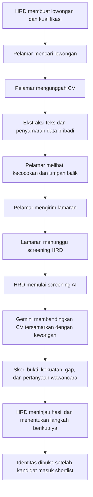

# Materi Presentasi HireMatch AI

## Ringkasan proyek

HireMatch AI adalah portal pencarian kerja dan rekrutmen yang membantu pelamar memahami kecocokan CV terhadap lowongan, serta membantu HRD meninjau lamaran dengan penilaian yang lebih terstruktur. AI memberikan rekomendasi dan bukti pendukung; keputusan seleksi tetap berada pada HRD.

## Alur kerja



### Dari sisi pelamar

1. Pelamar membuat akun, mencari lowongan, lalu mengunggah CV dalam format yang didukung.
2. Sistem mengekstrak teks CV dan menyamarkan informasi pribadi sebelum teks digunakan untuk analisis AI.
3. Pelamar dapat melihat skor kecocokan dan saran terkait lowongan.
4. Setelah melamar, screening HRD berada pada status menunggu sampai HRD memulainya.
5. Pelamar dapat menghapus teks CV tersimpan beserta hasil screening AI. Riwayat lamarannya tetap ada.

### Dari sisi HRD

1. HRD membuat lowongan dan mengisi deskripsi serta kualifikasi.
2. HRD mengatur bobot keterampilan, pengalaman, dan pendidikan. Jumlah bobot harus 100%; nilai awalnya 60%, 30%, dan 10%.
3. Lamaran baru tidak langsung discreen. HRD memilih untuk memulai screening.
4. Sistem menampilkan empat tahap: memeriksa CV, menyamarkan identitas, membandingkan kualifikasi, dan menyusun evaluasi.
5. HRD meninjau skor, bukti dari CV, kekuatan, gap, dan pertanyaan wawancara sebelum mengambil keputusan.
6. Nama dan kontak pelamar tetap disamarkan sampai pelamar masuk shortlist.

## Peran AI

Gemini digunakan untuk memvalidasi dan merapikan teks CV yang telah disamarkan, membandingkan makna kompetensi dalam CV dengan kebutuhan lowongan, serta menyusun ringkasan evaluasi. Hasilnya mencakup subskor keterampilan, pengalaman, dan pendidikan, kecocokan/gap skill, kutipan bukti, umpan balik untuk pelamar, dan pertanyaan wawancara.

Skor akhir dihitung aplikasi dari subskor dan bobot HRD. Secara umum:

```text
skor akhir = (subskor keterampilan × bobot keterampilan
             + subskor pengalaman × bobot pengalaman
             + subskor pendidikan × bobot pendidikan)
             ÷ total bobot yang berlaku
```

Jika pendidikan bukan persyaratan lowongan, komponen pendidikan tidak dihitung dan bobot kriteria lain dinormalisasi. Jika syarat *must-have* tidak terpenuhi, skor akhir dibatasi maksimal 59. Kategori skor yang digunakan adalah 80–100 Highly Recommended, 60–79 Potential, dan 0–59 Not Recommended.

**Contoh rumus (ilustrasi, bukan hasil kandidat):** subskor keterampilan 80, pengalaman 70, dan pendidikan 90 dengan bobot 60/30/10 menghasilkan skor akhir 77.

## Apa yang tidak dilakukan AI

- AI tidak memutuskan siapa yang diterima atau ditolak. HRD tetap meninjau hasil dan mengubah status lamaran.
- Skor bukan probabilitas kandidat akan sukses bekerja dan bukan penilaian atas nilai seseorang.
- Sistem tidak membuktikan kebenaran klaim dalam CV atau memverifikasi kemampuan kandidat secara eksternal.
- Sistem tidak membandingkan kandidat terhadap performa kerja setelah perekrutan.
- Bobot HRD berlaku pada screening yang dimulai setelah perubahan disimpan; skor screening yang sudah selesai tidak berubah otomatis.

## Batasan dan cara membaca hasil

1. **Skor bergantung pada mutu input.** CV yang sulit dibaca atau kualifikasi lowongan yang terlalu umum dapat menghasilkan pencocokan yang kurang tepat.
2. **AI dapat keliru atau melewatkan bukti.** HRD sebaiknya membuka kutipan CV dan membandingkannya dengan kualifikasi sebelum mengambil keputusan.
3. **Nilai keyakinan AI belum terkalibrasi sebagai probabilitas.** Nilai tersebut berasal dari keluaran model; angka 100% tidak berarti kepastian matematis.
4. **Penyamaran data pribadi bukan jaminan sempurna.** Nama institusi dan tautan identitas disamarkan, tetapi teks CV dapat tetap mengandung petunjuk identitas atau proksi bias.
5. **Pendidikan hanya dihitung bila relevan dengan persyaratan.** Nama atau reputasi institusi tidak boleh menjadi dasar penilaian.
6. **Model dan prompt dapat memengaruhi hasil.** Perubahan model, instruksi, atau bobot sebaiknya diikuti evaluasi pada contoh yang sudah dianonimkan dan ditinjau perekrut.

## Privasi data

CV disimpan sebagai teks pada profil pelamar. Teks yang sudah disamarkan dikirim ke Gemini untuk analisis; hasil screening disimpan agar dapat ditinjau pada riwayat lamaran. Pelamar dapat menghapus CV tersimpan dan hasil screening AI melalui halaman CV & Analisis AI. Penghapusan tersebut tidak menghapus riwayat lamaran.

Saat mempresentasikan proyek, jangan tampilkan CV atau identitas kandidat sungguhan. Gunakan akun dan data demo yang memang disiapkan untuk demonstrasi.

## Naskah demo singkat

1. Tunjukkan lowongan dan kualifikasi yang dibuat HRD.
2. Masuk sebagai pelamar, buka lowongan, dan jelaskan skor sebagai kecocokan CV terhadap persyaratan.
3. Kirim lamaran dan tunjukkan bahwa screening belum berjalan otomatis.
4. Kembali sebagai HRD, mulai screening dan jelaskan empat tahap progresnya.
5. Buka hasil seorang kandidat: bandingkan skor berbobot dengan bukti CV, kekuatan, dan gap.
6. Tunjukkan bahwa identitas masih disamarkan, lalu jelaskan keputusan shortlist tetap dilakukan HRD.
7. Tutup dengan batasan: hasil AI adalah bahan bantu yang perlu diverifikasi manusia.

## Jawaban singkat untuk pertanyaan umum

**Mengapa AI tidak langsung menyaring saat lamaran masuk?**  
Screening dimulai oleh HRD agar prosesnya terkontrol dan progres analisis dapat ditinjau.

**Apakah skor 100% berarti kandidat pasti cocok?**  
Tidak. Itu skor kecocokan yang dihasilkan berdasarkan CV dan persyaratan yang tersedia, bukan kepastian keberhasilan kerja.

**Apakah keyakinan 100% berarti AI pasti benar?**  
Tidak. Nilai keyakinan adalah keluaran model dan belum merupakan probabilitas yang terkalibrasi.

**Apakah AI menolak pelamar secara otomatis?**  
Tidak. AI memberi skor dan bahan pertimbangan; keputusan tetap dibuat HRD.
